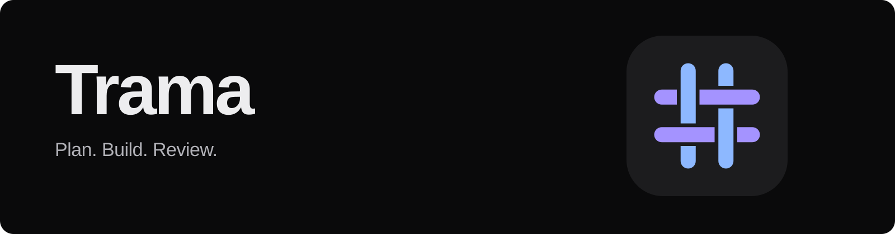
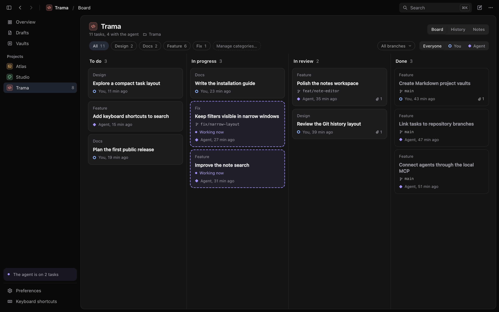
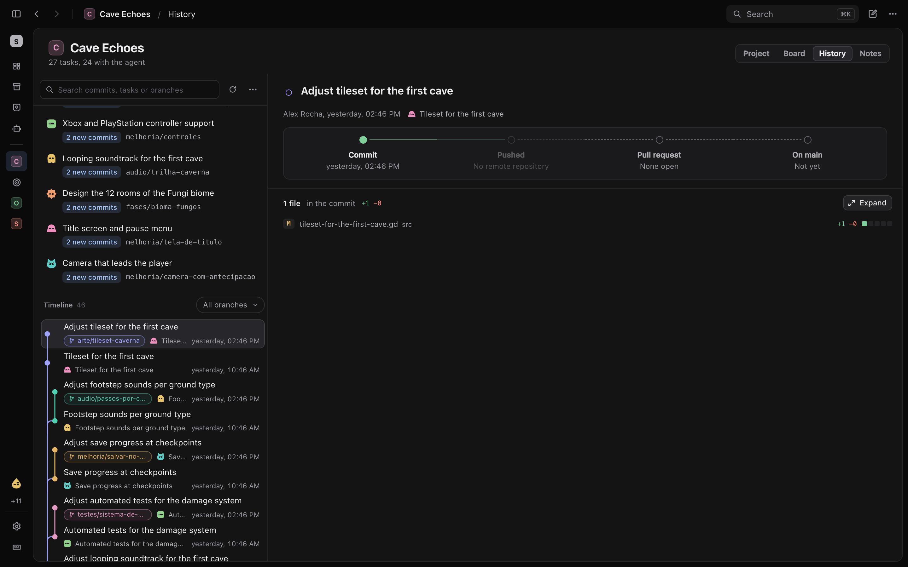
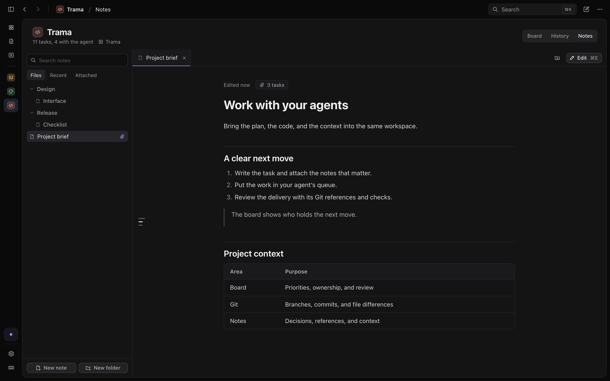

<p align="center">
  <strong>English</strong> &nbsp;·&nbsp; <a href="README.pt-BR.md">Português brasileiro</a>
</p>

<p align="center">
  
</p>

<p align="center">
  <strong>A local workspace for working with coding agents.</strong><br>
  Keep the plan, the code history, and the context together, from briefing to review.
</p>

<p align="center">
  <a href="https://trama.ajaxdev.com.br">Website</a> &nbsp;·&nbsp;
  <a href="#get-started">Get started</a> &nbsp;·&nbsp;
  <a href="docs/installation.md">Installation & MCP setup</a> &nbsp;·&nbsp;
  <a href="#development">Run from source</a>
</p>



## A clear next move

Write the briefing, attach the context, and put the task in your agent's queue. Trama shows who holds the work, what is in progress, and what needs your review. Your coding agent works in its own client and reads and updates the board through MCP.

**Tasks, Git, and notes share the same project.** A task can carry its briefing, discussion, checks, agent summary, linked notes, and delivery references, so the handoff comes with the context needed to review it.

## Get started

Trama is in early development. Desktop installers have not been published yet; you can [run it from source](#development) today. The planned download channel is GitHub Releases, with a `.dmg` for macOS and an `.exe` for Windows.

The interface is available in English and Brazilian Portuguese. Choose your language in **Preferences → Language**. The screenshots show the real interface with demonstration data.

## A board for you and your agents

Move work through **To do → In progress → In review → Done**. Assign tasks to yourself or an agent, organize them with categories and local branches, and keep unfinished ideas in drafts.

- Drag cards or move them with the keyboard.
- Read the activity history and the agent's delivery summary before reviewing.
- Keep personal task notes private from MCP clients.
- Archive completed work and bring it back when needed.
- See where work is waiting across projects in the overview.

## Follow the work into Git

Browse local changes, branches, commits, and linked tasks in one history. Open changed files in a side-by-side or inline diff, inspect commit details, and see pull requests through the GitHub CLI.

Trama's Git view is read-only. You and your coding tools keep control of commits, branches, and merges.



## Keep the context in Markdown

Point a project at a folder of Markdown files. Browse and search the vault, open notes in tabs, and edit with formatting tools and a live preview. Attach the relevant notes to tasks so an agent can read the same context.

Your notes stay ordinary `.md` files in the folder you choose. Trama checks for external changes before saving.



## Connect your coding agent

The desktop bundle includes **`trama-agent`**, a local MCP server over STDIO. Connect it to Codex, Claude Code, OpenCode, or another client that supports local MCP servers.

The agent can read briefings, update tasks, record delivery references, and work with project notes. Private task notes are excluded from its tools. Trama does not launch or host coding agents.

1. Install or build Trama.
2. [Connect your MCP client](docs/installation.md#connect-your-agent).
3. Add the included [Trama skill](skills/trama/SKILL.md) to teach your agent the queue, delivery, and review workflow.

## Your workspace stays local

| Data | Where it lives |
| --- | --- |
| Projects, tasks, and activity | A local SQLite database |
| Project notes | The Markdown folder you choose |
| Code and Git history | Your existing local repositories |

Trama has no account or cloud sync. Your agent's access to data is governed by its own client and provider; connecting it through MCP lets it read the project context exposed by Trama.

See the [installation guide](docs/installation.md#local-data) for database locations.

## Support and feedback

Found a bug or have an idea for Trama? [Report a bug](https://github.com/builtbyajax/Trama/issues/new?template=bug_report.yml) or [suggest a feature](https://github.com/builtbyajax/Trama/issues/new?template=feature_request.yml). You can write in English or Portuguese. Please remove private information from screenshots and logs before sharing them.

## Development

Built with **Tauri 2, React, TypeScript, and Rust**, with SQLite for local storage.

You need Node.js **22.12+**, Rust **1.90+**, and the [Tauri prerequisites](https://v2.tauri.app/start/prerequisites/) for your platform. Git enables repository features; an installed and authenticated [GitHub CLI](https://cli.github.com/) enables pull request lookup.

From the repository root:

```sh
cd app
npm ci
npm run tauri dev
```

For the browser development view, run `npm run dev` instead. It uses the same Rust core through a local development bridge at `http://127.0.0.1:1420`.

Development commands use `.trama-local/development` for their data by default, so schema changes do not migrate the installed app's databases. An explicit `TRAMA_HOME` or `TRAMA_DB` selects another location. Set `TRAMA_DEV_PERSONAL=1` only when you intend to use and potentially migrate your personal data.

To build a desktop package on your platform:

```sh
npm run tauri build
```

Build output is written to `app/src-tauri/target/release/bundle/` and includes the MCP server. Signing and release distribution are separate from a local build.

Before sending changes, run these checks from `app/`:

```sh
npm run typecheck
npm run format:check
cargo clippy --manifest-path src-tauri/Cargo.toml --all-targets --features agent-cli,dev-bridge -- -D warnings
```

Use `TRAMA_DB` to point a development session at a separate database.

<details>
<summary>Keyboard shortcuts</summary>

Use ⌘ on macOS and Ctrl on Windows. Project tabs use ⌃ on macOS and Alt on Windows.

| Shortcut on macOS | Action |
| --- | --- |
| `⌘N` | New task |
| `⇧⌘N` | New project |
| `⌘K` | Search |
| `⌘1…9` | Switch project |
| `⌘T` | Find a project by name |
| `⌥⌘1` / `⌥⌘2` / `⌥⌘3` | Overview / Drafts / Vaults |
| `⌃1` / `⌃2` / `⌃3` | Board / Git history / Notes |
| `⌘[` / `⌘]` | Back / Forward |
| `⌘B` | Toggle sidebar |
| `⌘,` | Preferences |
| `⌘/` | All shortcuts |

</details>

## License

This project is made available under the PolyForm Noncommercial License 1.0.0.

You may use, study, modify, and redistribute this software for purposes permitted by the license, including personal, educational, and noncommercial uses.

Commercial use is not permitted without an additional license, except for uses expressly permitted by the PolyForm terms. For commercial licensing, contact the project maintainer.

See [LICENSE](LICENSE) for the complete terms. If this summary differs from the license, the license text controls.
