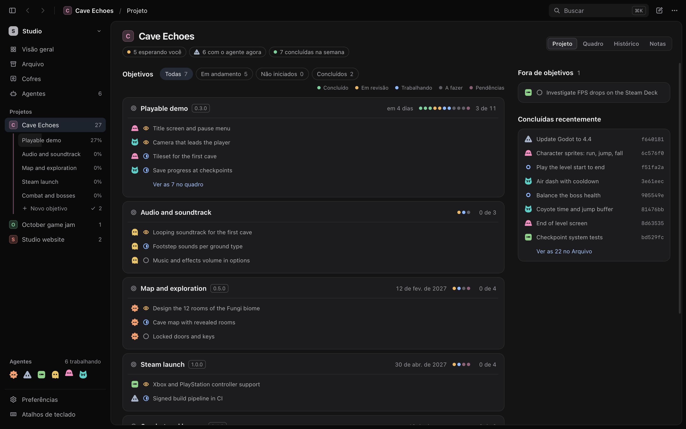
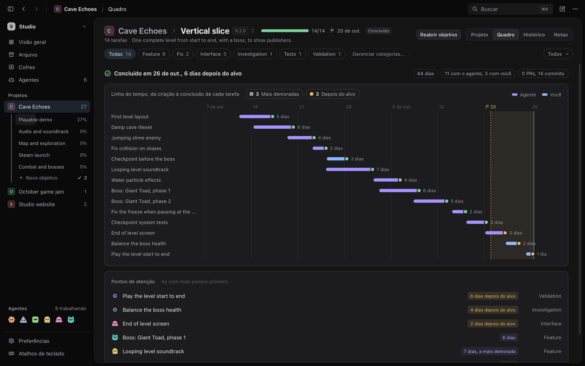
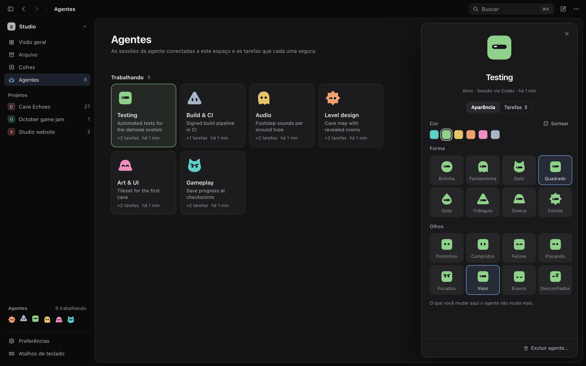

  <a href="README.md">English</a> &nbsp;·&nbsp; <strong>Português brasileiro</strong>

  

  <strong>Reúna tarefas, histórico do código e contexto do projeto — seja trabalhando por conta própria ou com agentes de código.</strong>

  <a href="https://trama.ajaxdev.com.br/pt/">Site de apresentação</a> &nbsp;·&nbsp;
  <a href="#primeiros-passos">Primeiros passos</a> &nbsp;·&nbsp;
  <a href="docs/installation.pt-BR.md">Instalação e configuração do MCP</a> &nbsp;·&nbsp;
  <a href="docs/development.pt-BR.md">Guia de desenvolvimento</a> &nbsp;·&nbsp;
  <a href="CHANGELOG.pt-BR.md">Histórico de versões</a>

## Primeiros passos

O Trama está em desenvolvimento inicial. Baixe um instalador de teste no [GitHub Releases](https://github.com/builtbyajax/Trama/releases) para macOS (Apple Silicon ou Intel) ou Windows x64 e siga o [guia de instalação](docs/installation.pt-BR.md) antes de abrir o app.

A interface está disponível em inglês e português brasileiro. Escolha o idioma em **Preferências → Geral → Idioma**. As capturas mostram a interface real com dados de demonstração.

## Mantenha o trabalho e o contexto juntos

1. Crie uma tarefa com o briefing e as verificações necessárias para o trabalho.
2. Mova-a por **Pendências → A fazer → Trabalhando → Em revisão**. Atribua a tarefa a você ou a um agente.
3. Revise o resumo, a atividade, as notas e as mudanças no Git antes de decidir o próximo passo.

Use o Trama por conta própria para organizar o projeto e acompanhar o histórico do trabalho. Conecte um agente de código quando quiser que ele leia o contexto das tarefas e atualize o mesmo quadro.

- Organize o trabalho com categorias, branches locais e objetivos com versões e datas-alvo.
- Mantenha suas anotações pessoais das tarefas privadas para os clientes MCP.
- Arquive tarefas concluídas e encontre trabalhos de vários projetos na visão geral.

## Objetivos

Reúna tarefas em um objetivo para acompanhar o progresso do projeto. Defina uma data-alvo e uma versão e conclua o objetivo quando o trabalho terminar.

## Conecte seu agente de código

O aplicativo inclui o **`trama-agent`**, um servidor MCP local por STDIO. Conecte-o ao Codex, Claude Code, OpenCode ou outro cliente compatível com servidores MCP locais.

O agente pode ler briefings, atualizar tarefas, anexar notas do projeto e registrar referências de entrega. Cada sessão conectada tem um perfil com nome, personagem e estado de presença. O Trama não inicia nem hospeda agentes de código.

1. [Conecte seu cliente MCP](docs/installation.pt-BR.md#conecte-seu-agente).
2. Adicione a [skill do Trama](skills/trama/SKILL.md) para orientar o fluxo de fila, entrega e revisão.

A [skill opcional de planejamento](skills/trama-planning/SKILL.md) ajuda os agentes a dividir um objetivo em tarefas e coordenar o trabalho no mesmo quadro.

## Acompanhe as mudanças no Git

Consulte alterações locais, branches, commits e tarefas vinculadas em um único histórico. Abra diferenças entre arquivos lado a lado ou em linha, veja os detalhes de cada commit e consulte pull requests pelo GitHub CLI.

A visualização de Git do Trama é somente para consulta. Você e suas ferramentas de código continuam controlando commits, branches e merges.

## Mantenha as notas do projeto em Markdown

Conecte uma pasta de arquivos Markdown ao projeto. Navegue e busque nas notas, abra-as em abas e edite com ferramentas de formatação e prévia ao vivo. Anexe notas relevantes às tarefas para que o agente possa consultar o mesmo contexto.

Suas notas continuam como arquivos `.md` comuns, na pasta que você escolheu. O Trama verifica alterações externas antes de salvar.

## Seus dados ficam no seu computador

| Dados | Onde ficam |
| --- | --- |
| Projetos, tarefas e atividade | Em um banco SQLite local |
| Notas do projeto | Na pasta Markdown que você escolheu |
| Código e histórico Git | Nos seus repositórios locais existentes |

O Trama não tem conta nem sincronização na nuvem. Ao conectar um agente pelo MCP, ele pode acessar o contexto do projeto que o Trama disponibiliza. O cliente e o provedor do agente têm suas próprias políticas de dados.

Consulte os caminhos do banco de dados no [guia de instalação](docs/installation.pt-BR.md#dados-locais).

## Suporte e sugestões

Encontrou um problema ou tem uma ideia para o Trama? [Reporte um bug](https://github.com/builtbyajax/Trama/issues/new?template=bug_report.yml) ou [sugira uma melhoria](https://github.com/builtbyajax/Trama/issues/new?template=feature_request.yml). Você pode escrever em português ou inglês.

## Desenvolvimento

O Trama é feito com **Tauri 2, React, TypeScript, Rust e SQLite**. Consulte o [guia de desenvolvimento](docs/development.pt-BR.md) para configurar o ambiente, usar dados locais de desenvolvimento, compilar e executar verificações. Veja [Testes e CI](docs/testing.md) para conhecer os testes e os workflows.

## Licença

Este projeto é disponibilizado sob a PolyForm Noncommercial License 1.0.0.

Você pode usar, estudar, modificar e redistribuir este software para as finalidades permitidas pela licença, incluindo usos pessoais, educacionais e não comerciais.

O uso comercial não é permitido sem uma licença adicional, exceto nos casos expressamente permitidos pelos termos da PolyForm. Para solicitar uma licença comercial, entre em contato com o mantenedor do projeto.

Consulte [LICENSE](LICENSE) para ver os termos completos. Em caso de divergência entre este resumo e o texto da licença, prevalece o texto da licença.
