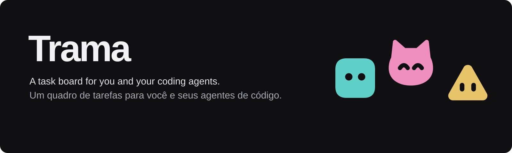
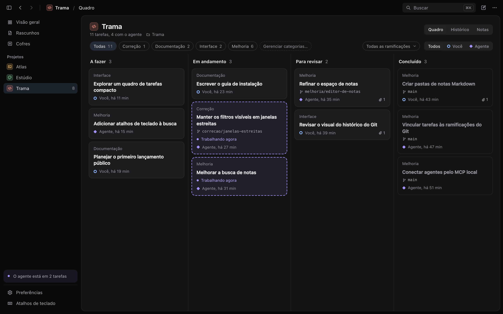
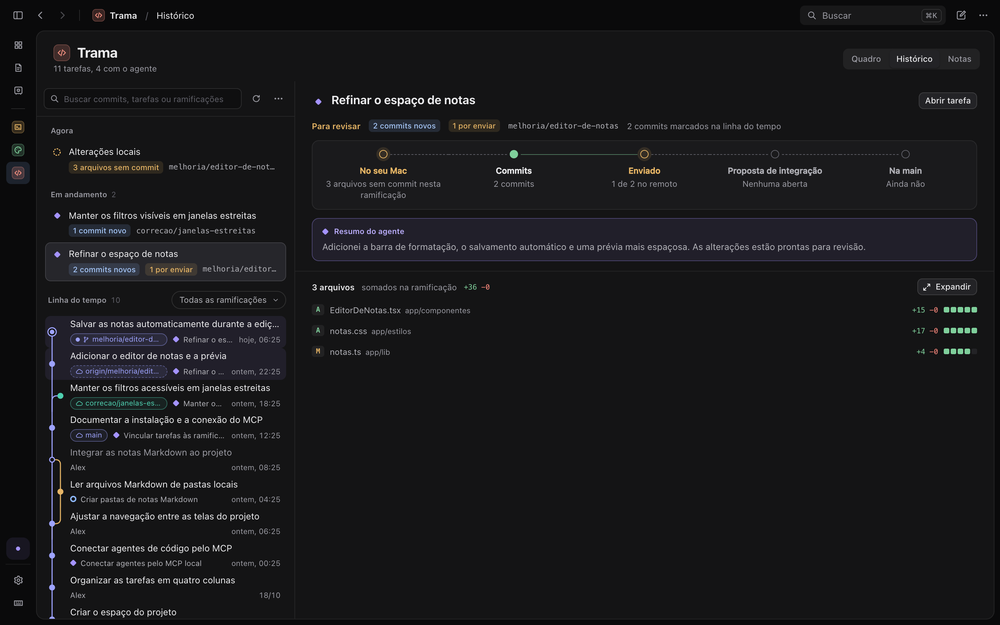
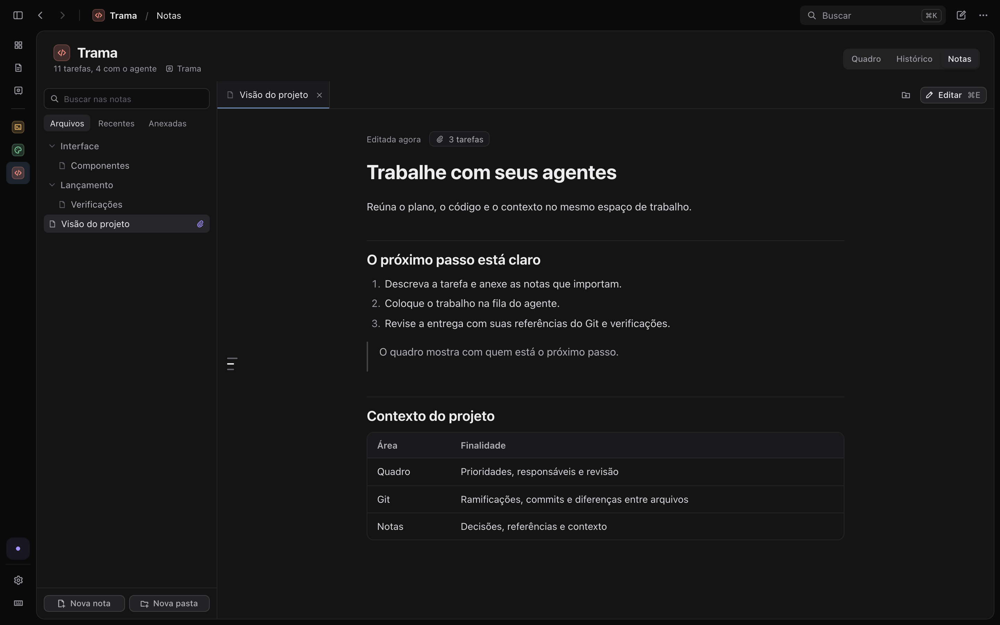

<p align="center">
  <a href="README.md">English</a> &nbsp;·&nbsp; <strong>Português brasileiro</strong>
</p>

<p align="center">
  
</p>

<p align="center">
  <strong>Um quadro de tarefas para você e seus agentes de código.</strong><br>
  Reúna o plano, o histórico do código e o contexto, do briefing à revisão.
</p>

<p align="center">
  <a href="https://trama.ajaxdev.com.br/pt/">Site de apresentação</a> &nbsp;·&nbsp;
  <a href="#primeiros-passos">Primeiros passos</a> &nbsp;·&nbsp;
  <a href="docs/installation.pt-BR.md">Instalação e configuração do MCP</a> &nbsp;·&nbsp;
  <a href="#desenvolvimento">Executar pelo código-fonte</a> &nbsp;·&nbsp;
  <a href="CHANGELOG.pt-BR.md">Histórico de versões</a>
</p>



## O próximo passo está claro

1. Escreva uma tarefa e dê ao agente o contexto necessário.
2. O agente trabalha no próprio cliente e atualiza a tarefa pelo MCP.
3. Revise a entrega e decida o próximo passo.

**Quadro, Git e notas fazem parte do mesmo projeto.** Cada tarefa pode reunir briefing, conversa, verificações, resumo do agente, notas anexadas e referências da entrega, para que a revisão venha acompanhada do contexto necessário.

## Primeiros passos

O Trama está em desenvolvimento inicial. Baixe os instaladores de teste no [GitHub Releases](https://github.com/builtbyajax/Trama/releases), com um `.dmg` para macOS e um `.exe` para Windows, ou [execute pelo código-fonte](#desenvolvimento). Leia o [guia de instalação](docs/installation.pt-BR.md) antes de abrir o app.

A interface está disponível em inglês e português brasileiro. Escolha o idioma em **Preferências → Geral → Idioma**. As capturas mostram a interface real com dados de demonstração.

## Um quadro para você e seus agentes

Mova o trabalho por **Pendências → A fazer → Trabalhando → Em revisão** e conclua no Arquivo. Atribua tarefas a você ou ao agente, organize-as por categorias e branches locais e mantenha as ideias que ainda não estão prontas em Pendências.

- Arraste cartões ou mova-os pelo teclado.
- Consulte a atividade e o resumo da entrega antes de revisar.
- Mantenha anotações pessoais da tarefa privadas para os clientes MCP.
- Arquive o trabalho concluído e restaure-o quando precisar.
- Veja na visão geral onde o trabalho está parado entre seus projetos.

## Agentes

Cada sessão de agente conectada tem um perfil com nome, personagem e estado de presença. Veja qual agente está com cada tarefa e acompanhe o trabalho no quadro e na atividade. No macOS, você pode escolher manter o Mac acordado enquanto os agentes trabalham.

## Objetivos

Reúna tarefas em um objetivo e acompanhe seu progresso no projeto. Objetivos podem ter data-alvo e versão e podem ser concluídos quando o trabalho terminar.

## Acompanhe o trabalho no Git

Consulte alterações locais, branches, commits e tarefas vinculadas em um único histórico. Abra diferenças entre arquivos lado a lado ou em linha, veja os detalhes de cada commit e consulte pull requests pelo GitHub CLI.

A visualização de Git do Trama é somente para consulta. Você e suas ferramentas de código continuam controlando commits, branches e merges.



## Mantenha o contexto em Markdown

Vincule o projeto a uma pasta de arquivos Markdown. Navegue e busque no cofre, abra notas em abas e edite com ferramentas de formatação e prévia ao vivo. Anexe as notas relevantes às tarefas para que o agente possa consultar o mesmo contexto.

Suas notas continuam sendo arquivos `.md` comuns, na pasta que você escolheu. O Trama verifica alterações externas antes de salvar.



## Conecte seu agente de código

O pacote do aplicativo inclui o **`trama-agent`**, um servidor MCP local por STDIO. Conecte-o ao Codex, Claude Code, OpenCode ou outro cliente que aceite servidores MCP locais.

O agente pode ler briefings, atualizar tarefas, registrar referências da entrega e trabalhar com as notas do projeto. As anotações privadas das tarefas ficam fora das suas ferramentas. O Trama não inicia nem hospeda agentes de código.

1. Instale ou compile o Trama.
2. [Conecte seu cliente MCP](docs/installation.pt-BR.md#conecte-seu-agente).
3. Adicione a [skill do Trama](skills/trama/SKILL.md) para ensinar ao agente o fluxo de fila, entrega e revisão.

A [skill opcional de planejamento](skills/trama-planning/SKILL.md) ajuda os agentes a dividir um objetivo em tarefas e coordenar o trabalho no mesmo quadro.

## Seu espaço de trabalho fica local

| Dados | Onde ficam |
| --- | --- |
| Projetos, tarefas e atividade | Em um banco SQLite local |
| Notas do projeto | Na pasta Markdown que você escolheu |
| Código e histórico Git | Nos seus repositórios locais existentes |

O Trama não tem conta nem sincronização com a nuvem. O acesso do agente aos dados segue as regras do cliente e do provedor que você usa; conectá-lo por MCP permite que ele leia o contexto do projeto exposto pelo Trama.

Consulte os caminhos do banco de dados no [guia de instalação](docs/installation.pt-BR.md#dados-locais).

## Suporte e sugestões

Encontrou um problema ou tem uma ideia para o Trama? [Reporte um bug](https://github.com/builtbyajax/Trama/issues/new?template=bug_report.yml) ou [sugira uma melhoria](https://github.com/builtbyajax/Trama/issues/new?template=feature_request.yml). Você pode escrever em português ou inglês. Remova informações privadas de capturas de tela e logs antes de compartilhá-los.

## Desenvolvimento

Feito com **Tauri 2, React, TypeScript e Rust**, com SQLite para armazenamento local.

Você precisa de Node.js **22.12+**, Rust **1.90+** e dos [pré-requisitos do Tauri](https://v2.tauri.app/start/prerequisites/) para seu sistema. O Git habilita os recursos de repositório; o [GitHub CLI](https://cli.github.com/) instalado e autenticado permite consultar pull requests.

A partir da raiz do repositório:

```sh
cd app
npm ci
npm run tauri dev
```

Para abrir a interface de desenvolvimento no navegador, use `npm run dev`. Ela se conecta ao mesmo núcleo Rust por uma ponte local em `http://127.0.0.1:1420`.

Os comandos de desenvolvimento usam `.trama-local/development` para os dados por padrão, evitando que mudanças de schema migrem os bancos do app instalado. `TRAMA_HOME` ou `TRAMA_DB` explícitos selecionam outro local. Use `TRAMA_DEV_PERSONAL=1` somente quando quiser usar e possivelmente migrar seus dados pessoais.

Para gerar o pacote do aplicativo no seu sistema:

```sh
npm run tauri build
```

O resultado fica em `app/src-tauri/target/release/bundle/` e inclui o servidor MCP. A assinatura e a distribuição de releases são etapas separadas da compilação local.

Antes de enviar mudanças, execute estas verificações a partir de `app/`:

```sh
npm run typecheck
npm run format:check
npm test
cargo test --locked --manifest-path src-tauri/Cargo.toml --features agent-cli,dev-bridge
cargo clippy --manifest-path src-tauri/Cargo.toml --all-targets --features agent-cli,dev-bridge -- -D warnings
```

Use `TRAMA_DB` para apontar uma sessão de desenvolvimento para um banco separado.

[Testes e CI](docs/testing.md)

<details>
<summary>Atalhos de teclado</summary>

Use ⌘ no macOS e Ctrl no Windows. As abas do projeto usam ⌃ no macOS e Alt no Windows.

| Atalho no macOS | Ação |
| --- | --- |
| `⌘N` | Nova tarefa |
| `⇧⌘N` | Novo projeto |
| `⌘K` | Buscar |
| `⌘R` | Atualizar |
| `⌘1…9` | Trocar de projeto |
| `⌘T` | Encontrar um projeto pelo nome |
| `⌥⌘1` / `⌥⌘2` / `⌥⌘3` | Visão geral / Arquivo / Cofres |
| `⌃1` / `⌃2` / `⌃3` / `⌃4` | Projeto / Quadro / Histórico Git / Notas |
| `⇧⌘L` | Alternar o quadro entre Kanban e Lista |
| `⌘[` / `⌘]` | Voltar / Avançar |
| `⌘B` | Mostrar ou ocultar a barra lateral |
| `⌘,` | Preferências |
| `⌘/` | Todos os atalhos |
| `↑` / `↓` | Tarefa anterior / próxima com uma tarefa aberta |
| `⌘↵` | Alternar a tarefa aberta entre página inteira e painel |
| `Esc` | Fechar a tarefa aberta ou cancelar o movimento de um cartão |
| `Enter` / `Espaço` | Abrir um cartão / pegar ou soltar um cartão |
| `←` / `→` / `↑` / `↓` | Escolher a coluna ou posição ao mover um cartão |
| `Enter` | Salvar no campo de título ou abrir as alterações de um commit |
| `⌘E` | Ler ou editar uma nota |
| `↑` / `↓` | Percorrer commits no histórico Git |
| `⌥↑` / `⌥↓` | Arquivo alterado anterior / próximo |
| `Esc` | Voltar ao histórico Git |

</details>

## Licença

Este projeto é disponibilizado sob a PolyForm Noncommercial License 1.0.0.

Você pode usar, estudar, modificar e redistribuir este software para as finalidades permitidas pela licença, incluindo usos pessoais, educacionais e não comerciais.

O uso comercial não é permitido sem uma licença adicional, exceto nos casos expressamente permitidos pelos termos da PolyForm. Para solicitar uma licença comercial, entre em contato com o mantenedor do projeto.

Consulte [LICENSE](LICENSE) para ver os termos completos. Em caso de divergência entre este resumo e a licença, prevalece o texto da licença.
